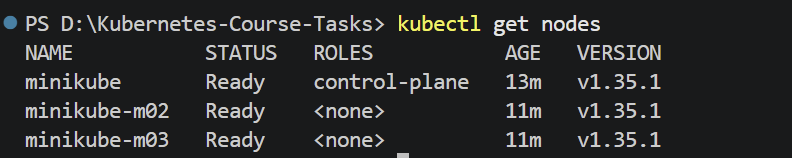
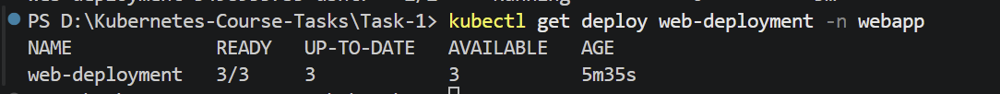
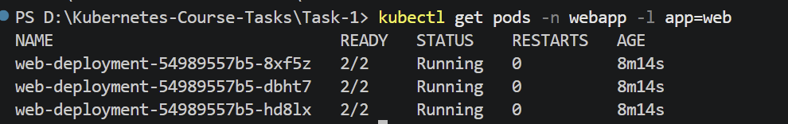
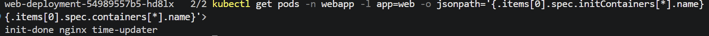
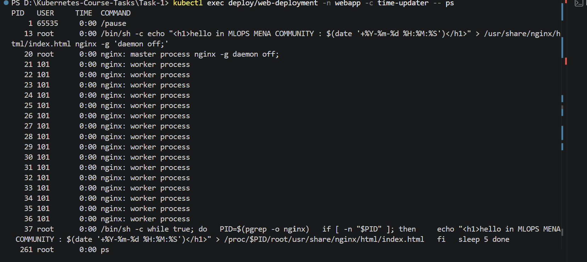
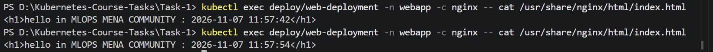
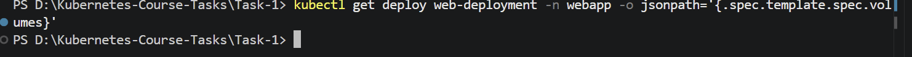
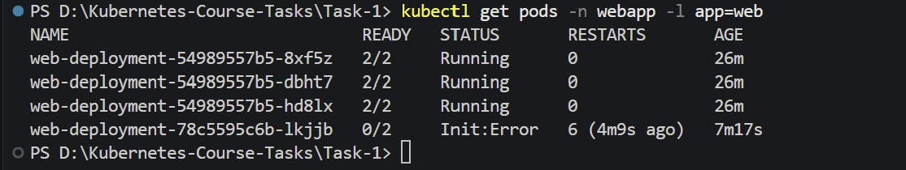
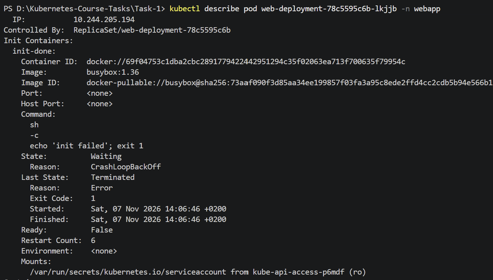
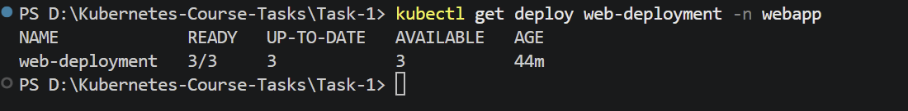

# Task 1: Multi-container Pods (init container and sidecar)

## Overview

A 3-node minikube cluster runs an nginx "hello" page whose time refreshes every 5 seconds. Each Pod in the Deployment has three containers and no volumes:

| Container | Type | Job |
|---|---|---|
| `init-done` | Init container | Prints `done` and exits. The other containers start only if it succeeds. |
| `nginx` | Main container | Writes `index.html` with the current time, then serves it on port 80. |
| `time-updater` | Sidecar | Rewrites `index.html` with the new time every 5 seconds. |

In the last part of the task, the init container is made to fail to see how Kubernetes handles a broken rollout.

## How the sidecar updates the page

The Pod has no shared volume, so the sidecar reaches nginx's files through the process tree:

- `shareProcessNamespace: true` puts all containers in one process namespace, so the sidecar can find nginx's PID with `pgrep -o nginx`.
- `/proc/<pid>/root` is the filesystem of that process, so `/proc/<pid>/root/usr/share/nginx/html/index.html` is the file nginx serves.
- The `SYS_PTRACE` capability is required to access another process's `/proc` entries.

## Files

| File | Purpose |
|---|---|
| `namespace.yaml` | Creates the `webapp` namespace |
| `deployment.yaml` | Deployment `web-deployment` (3 replicas, label `app: web`) |
| `screenshots/` | Screenshots referenced below |

## 1. Create the cluster

One control-plane node and two workers, with the Calico network plugin. `--memory` is a per-node limit.

```powershell
minikube start --nodes 3 --cni=calico --cpus 2 --memory 2200
kubectl get nodes
```

All three nodes (`minikube`, `minikube-m02`, `minikube-m03`) are `Ready`.



## 2. Create the namespace

```powershell
kubectl apply -f namespace.yaml
```

## 3. Write the Deployment

The starting file was generated with a client-side dry run, then edited:

```powershell
kubectl create deployment web-deployment --image=nginx:1.27 --replicas=3 -n webapp --dry-run=client -o yaml > deployment.yaml
```

Edits made to the generated file:

- Changed the label from `app: web-deployment` to `app: web` in `metadata.labels`, `selector.matchLabels` and the Pod template labels.
- Added `shareProcessNamespace: true` to the Pod spec.
- Added the `init-done` init container (`busybox:1.36`, `echo done`).
- Overrode the `nginx` command with `/bin/sh -c`: it writes the page, then runs `nginx -g 'daemon off;'`.
- Added the `time-updater` sidecar with `SYS_PTRACE` and the update loop.
- No `volumes` are defined.

## 4. Deploy and check

```powershell
kubectl apply -f deployment.yaml
kubectl get pods -n webapp -w
kubectl port-forward -n webapp deploy/web-deployment 8080:80
```

### Deployment is ready

`READY 3/3`.



### Pods are running

Three Pods, each `2/2 Running` (the finished init container is not counted).



### Page loads and the time changes

`http://localhost:8080` shows a different time after a refresh 5 seconds later (NB. the screenshots are more than 5 seconds apart).


## 5. Verify the containers

### Container names

Expected output: `init-done nginx time-updater`.

```powershell
kubectl get pods -n webapp -l app=web -o jsonpath='{.items[0].spec.initContainers[*].name} {.items[0].spec.containers[*].name}'
```



### Init container succeeded

```powershell
kubectl logs deploy/web-deployment -n webapp -c init-done
```


### Sidecar sees nginx

`ps` from the sidecar lists `nginx: master process`, which confirms the shared process namespace.

```powershell
kubectl exec deploy/web-deployment -n webapp -c time-updater -- ps
```



### Time updates

Reading `index.html` twice, 5 seconds apart, returns two different times.

```powershell
kubectl exec deploy/web-deployment -n webapp -c nginx -- cat /usr/share/nginx/html/index.html
```



### No volumes

The command returns empty output.

```powershell
kubectl get deploy web-deployment -n webapp -o jsonpath='{.spec.template.spec.volumes}'
```



## 6. Make the init container fail

Only the init container command was changed:

```yaml
command: ["sh", "-c", "echo 'init failed'; exit 1"]
```

```powershell
kubectl apply -f deployment.yaml
kubectl get pods -n webapp -w
```

### Pod status

The new Pod stays at `0/2` and alternates between `Init:Error` and `Init:CrashLoopBackOff`. The 3 old Pods remain `2/2 Running`.



### Error details

`kubectl describe pod <new-pod> -n webapp` shows `Exit Code: 1` for `init-done`.



## 7. Fix it

The original command was restored and applied:

```yaml
command: ["sh", "-c", "echo done"]
```

```powershell
kubectl apply -f deployment.yaml
kubectl get deploy web-deployment -n webapp
```

The restored template matched the original one, so the Deployment reused the original ReplicaSet and scaled the failed one to 0. The result is `READY 3/3` with no new Pods created.



## Answers

**Which status does the new Pod show?**
The new Pod stays at `0/2` and alternates between `Init:Error` and `Init:CrashLoopBackOff`. `Init:Error` appears right after the init container exits with code 1. `Init:CrashLoopBackOff` appears while Kubernetes waits before retrying. The wait roughly doubles after each failure, up to 5 minutes.

**Do nginx and time-updater start?**
No. Init containers must finish successfully (exit code 0) before any app container starts. Because `init-done` keeps failing, neither `nginx` nor `time-updater` is created.

**Is the page still reachable, and why?**
Yes. The Deployment uses a rolling update: it creates a new Pod first and deletes an old Pod only after the new one is Ready. The new Pod never becomes Ready, so the 3 old Pods keep running and serving traffic. After 10 minutes `kubectl rollout status` reports `exceeded its progress deadline`, but Kubernetes does not roll back on its own.

## Clean up

```powershell
kubectl delete namespace webapp
```