# Task Session 2: FastAPI + MySQL with ConfigMap, Secret & Ingress

## Description

A FastAPI guestbook app (2 replicas) with one MySQL server, deployed on a 3-node minikube cluster:

- MySQL keeps its data on a **PV + PVC**, so the data survives Pod restarts.
- The app settings are in a **ConfigMap**, and the MySQL credentials are in a **Secret**.
- Users reach the app through an **Ingress** (NGINX Ingress Controller).

The app (`webapp/`) and the MySQL image (`mysql/`) are provided. They are built, not changed.

## Architecture

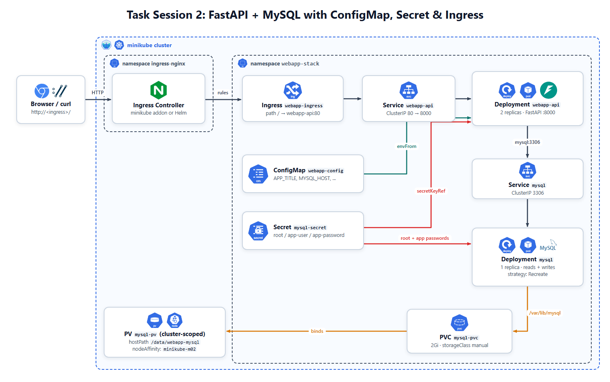

Browser → Ingress Controller → Ingress `webapp-ingress` → Service `webapp-api` (80 → 8000) → 2 app Pods → Service `mysql` (3306) → MySQL Pod → `mysql-pvc` → `mysql-pv` (on `minikube-m02`).

## What was done

| Step | Action | File |
|---|---|---|
| 1 | Built `webapp-api:task2` and `webapp-mysql:task2` and loaded them into minikube | - |
| 2 | Created the namespace `webapp-stack` | `01-namespace.yaml` |
| 3 | Created the Secret `mysql-secret` (root password, app user, app password) | `02-secret.yaml` |
| 4 | Created the ConfigMap `webapp-config` (app title, environment, MySQL host, port and database) | `03-configmap.yaml` |
| 5 | Created the PV `mysql-pv` (hostPath, 2Gi, pinned to `minikube-m02`) and the PVC `mysql-pvc` | `04-pv-pvc.yaml` |
| 6 | Deployed MySQL (1 replica, `Recreate`, data on `mysql-pvc`) with the Service `mysql` | `05-mysql.yaml` |
| 7 | Deployed the app (2 replicas, settings from the ConfigMap, credentials from the Secret) with the Service `webapp-api` | `06-webapp.yaml` |
| 8 | Installed the NGINX Ingress Controller (`minikube addons enable ingress`) | - |
| 9 | Created the Ingress `webapp-ingress` (`/` → `webapp-api:80`) | `07-ingress.yaml` |
| 10 | Opened the app with `kubectl port-forward` to the Ingress Controller (http://localhost:8080) | - |

The files are applied in this order, so everything a Pod refers to by name already exists when the Pod starts.

## Verification

- The `minikube image ls` output showing both `webapp-api:task2` and `webapp-mysql:task2`

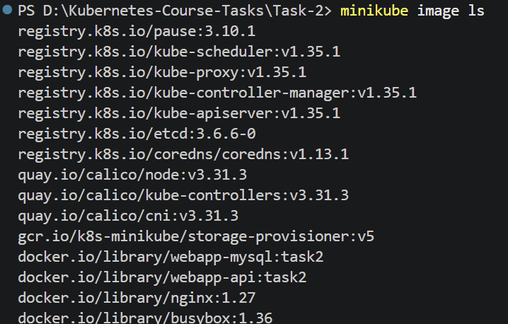

- Secret (`DATA 3`) and ConfigMap (`DATA 5`)

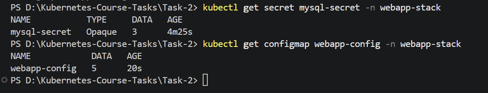

- PV and PVC bound (`2Gi`)

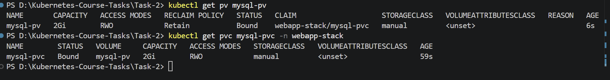

- Deployments ready (`mysql 1/1`, `webapp-api 2/2`)

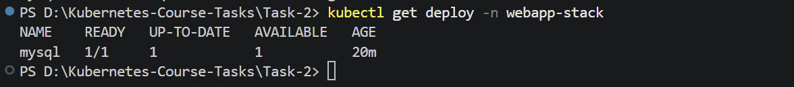

- 5: MySQL on the PV node (`minikube-m02`)

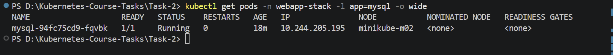

- 6: App env (values from the ConfigMap and the Secret)

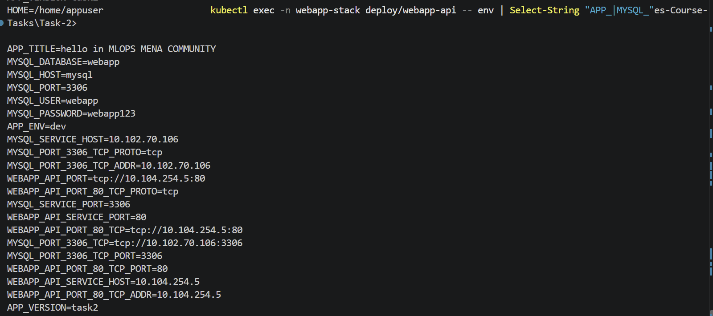

- 7: Default data (2 default messages)

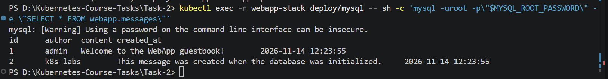

- 8: Ingress (class `nginx`, address filled)

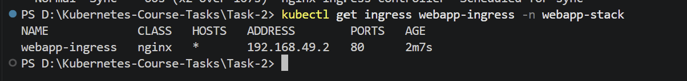

- The app in the browser

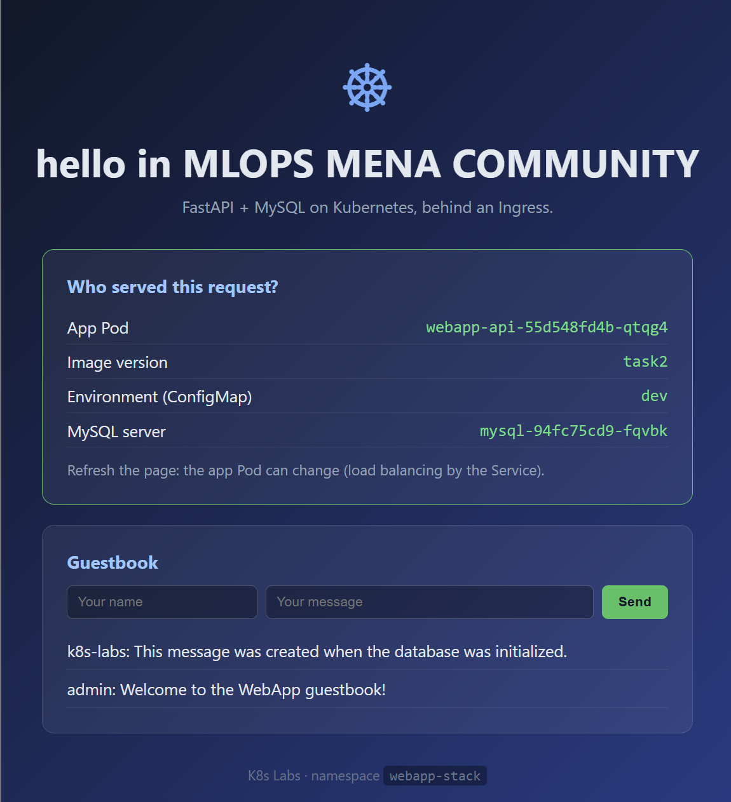

- 9: App info

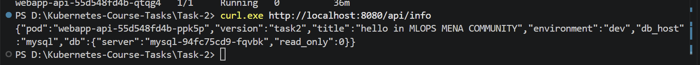

- 10: Write a message

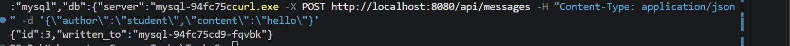

- 11: Read messages

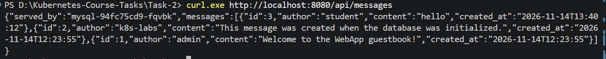

- 12: Data survives a restart (the MySQL Pod was deleted and recreated, and the message is still there)

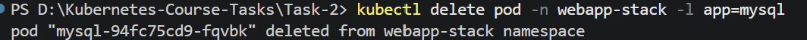

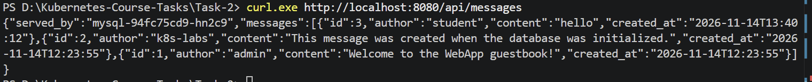

## Notes

- **Windows and `chmod -x`:** PowerShell has no `chmod`, and Docker marks files from a Windows folder as executable. The MySQL image was built under a temporary tag, then one extra layer ran `chmod -x /docker-entrypoint-initdb.d/01-setup.sh` and the result was tagged `webapp-mysql:task2`. The provided files are unchanged.
- **`MYSQL_PORT`:** kept in the ConfigMap, because Kubernetes injects `MYSQL_PORT=tcp://<ip>:3306` for the Service named `mysql`, and the ConfigMap value (`3306`) replaces it.
- **Reaching the Ingress on Windows:** the Ingress address (`192.168.49.2`) is inside Docker's network, so the app is opened through `kubectl port-forward -n ingress-nginx svc/ingress-nginx-controller 8080:80`.
- **PowerShell:** `curl.exe` is used instead of `curl`, with the JSON quotes escaped.
- All resources are kept for Task 3.